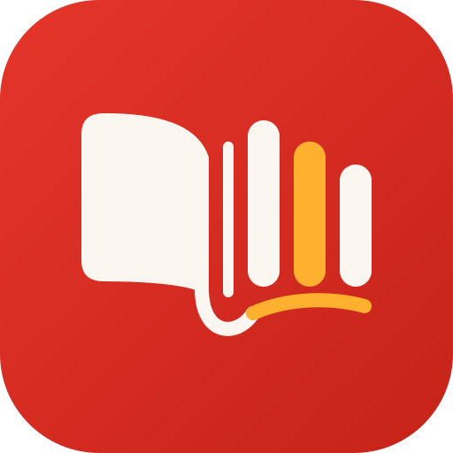

<p align="center">
  
</p>

# StoryDeck Touch

A dedicated bedside **touchscreen companion controller** for [Yoto](https://yoto.dev) players, powered by the **ESP32-S3**.

Listeners can browse their audiobook and music library with full-color cover art, pick individual chapters, and start playback on their Yoto Player with a single tap—without needing a phone or tablet nearby.

---

## 🌟 Modes of Operation

StoryDeck Touch supports two ways to run:

1. **StoryDeck Core Mode (Recommended):**
   * Connects to a self-hosted [**StoryDeck Core**](https://github.com/YotoStoryDeck/StoryDeck-Core) hub.
   * Shows curated libraries combining **Audiobookshelf** and **Yoto** playlists.
   * Supports **Listener Profiles**, content filtering, sleep timers, travel safety, and remote firmware updates.
   * Easy pairing: approve the screen from Core's Admin Console with one click—zero cloud secrets stored on the device.

2. **Standalone Mode (Direct Yoto Cloud):**
   * Works independently with no home server required.
   * Connects directly to your Yoto account over Wi-Fi and lists your Yoto cards and players.

---

## 📺 Screens & Controls

| Screen | What It Does |
| --- | --- |
| **Catalog Grid** | Clean cover-art grid for the device's assigned profile, with favorites, series grouping, and quick visual source badges. |
| **Book Detail** | Full cover art, browsable chapter/track list with 16×16 icons, Series view shortcut, and instant Play button. |
| **Now Playing** | Live playback progress, skip controls, chapter navigation, and volume slider respecting Yoto volume limits. |
| **Night Clock** | Low-glare bedtime clock with configurable sleep/wake color indicators and burn-in protection. |
| **Settings Menu** | Hidden 4-digit **Settings PIN** menu for Wi-Fi, operating mode, player lock, brightness, and sleep timers. |

---

## 🛠️ Hardware

Built for the **[Waveshare ESP32-S3-Touch-LCD-4.3B](https://www.waveshare.com/wiki/ESP32-S3-Touch-LCD-4.3B)** (4.3" `800×480` capacitive touchscreen powered over USB-C). 3D-printable desktop and wall-mount enclosures are included in `3d-models/`.

---

## 🚀 Getting Started (First-Time USB Install)

For a brand-new board, complete **Option 1** or **Option 2** over USB-C first. Once StoryDeck Touch is installed and connected to Wi-Fi, all future updates can be installed wirelessly (OTA).

### Option 1: Flash Pre-Built Firmware (No Build Tools Required)

* Connect the board via USB-C and install directly from Chrome or Edge using the **[StoryDeck Touch Web Flasher](https://yotostorydeck.github.io/StoryDeck-Touch/)**, or download `firmware-merged.bin` from [Releases](https://github.com/YotoStoryDeck/StoryDeck-Touch/releases) and flash with `esptool.py`:
  ```bash
  esptool.py -p COM_PORT -b 921600 write_flash 0x0 firmware-merged.bin
  ```

### Option 2: Build from Source (PlatformIO)

```bash
git clone https://github.com/YotoStoryDeck/StoryDeck-Touch.git
cd StoryDeck-Touch
pio run -e waveshare-s3-43b -t upload
```

---

## 📡 Wireless Firmware Updates (OTA — After Initial Install)

Once **StoryDeck Touch `v0.1.0+`** has been installed once over USB-C on your **Waveshare ESP32-S3-Touch-LCD-4.3B** and joined to your Wi-Fi network, you can update wirelessly without unplugging the display (your Wi-Fi and Yoto settings are preserved):

* **Without StoryDeck Core (Web Installer or On-Device Settings):**
  * **From the Web Installer:** Switch to the **Wireless Update (OTA)** tab on the **[StoryDeck Touch Web Flasher](https://yotostorydeck.github.io/StoryDeck-Touch/)**, enter your device IP or `storydeck-touch.local`, click **Send Update to Device**, and enter your 4-digit **Settings PIN** on the confirmation page.
  * **From the Device Settings Page:** Open `http://storydeck-touch.local/settings` (or `http://<device-ip>/settings`). StoryDeck Touch checks automatically for new releases on boot and once daily; click **Check for Updates** → **Install** (or visit `/update` to upload a downloaded `firmware.bin` manually).
* **With StoryDeck Core:** Open **Core Admin → Hardware Displays** to push official or custom updates (and 1-click rollbacks) to one or all displays.
* **Developer CLI (PlatformIO):** `pio run -e waveshare-s3-43b-ota -t upload --upload-port storydeck-touch.local`

> [!NOTE]
> **Prefer a Tablet Instead of ESP32 Hardware?** If you already have **StoryDeck Core** installed and running, open `http://<core-ip>:5055/kiosk/` on any modern iPad (`iPadOS 14+`), Android tablet, or Fire tablet to use the built-in **Tablet Kiosk** web app (not available in Standalone Mode).

---

## 🤖 AI Development Notice

This project utilizes artificial intelligence (AI) tools, including Anthropic Claude and Google Gemini / Antigravity, to assist in interface design, embedded drivers, simulation tooling, and documentation. All contributions are reviewed and tested against physical hardware.

---

## 📜 Credits & Lineage

* **Jay Heavner** ([@jayheavner](https://github.com/jayheavner)) — Creator of [yoto-esp32-controller](https://github.com/jayheavner/yoto-esp32-controller).
* **Mylacc** ([@mylacc](https://github.com/mylacc)) — Creator of [yoto-audiobookshelf-bridge](https://github.com/mylacc/yoto-audiobookshelf-bridge).
* **LVGL** ([@lvgl](https://github.com/lvgl)) — Light and Versatile Embedded Graphics Library.

---

## 📄 License

Licensed under the [MIT License](LICENSE). 3D enclosure files are licensed under [CC BY 4.0](https://creativecommons.org/licenses/by/4.0/).
